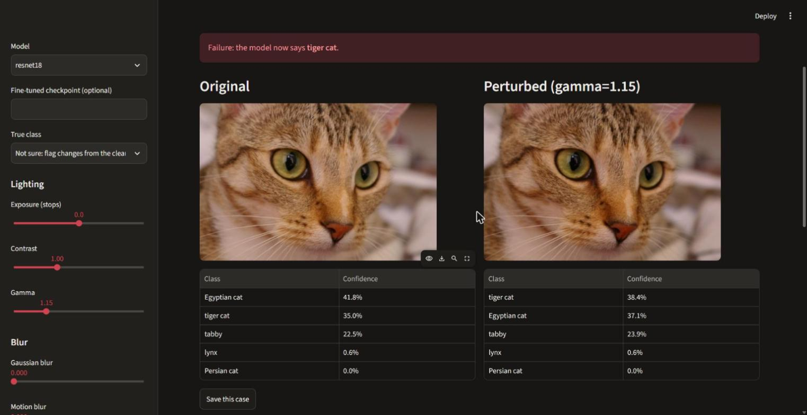
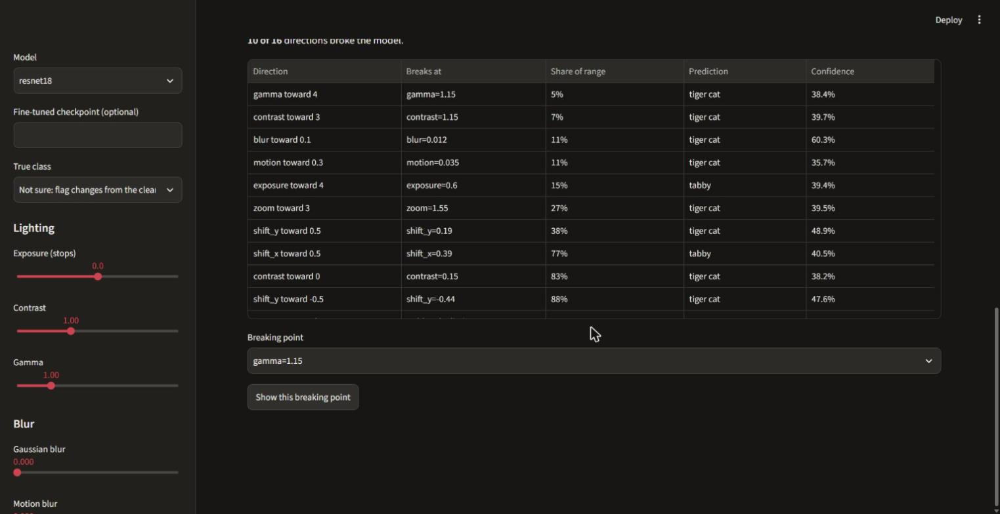

# Blindspot

[](https://github.com/hyxdo/blindspot/actions/workflows/ci.yml)

Image classifiers can be right about a photo and wrong about the same photo taken a little darker, a little blurrier, or framed a little differently. Blindspot finds those conditions, saves them so they can be reproduced exactly, and tests whether fine-tuning fixes them.



Built with Python, PyTorch, NumPy, OpenCV, and Streamlit.

## Try it

Python 3.10 or newer.

```bash
git clone https://github.com/hyxdo/blindspot.git
cd blindspot
python -m venv .venv
source .venv/bin/activate   # Windows: .venv\Scripts\activate
pip install -e ".[dev]"
blindspot app
```

Click **Use the sample photo**, then **Find breaking points**. The first run downloads the pretrained weights from torchvision.

## Finding what breaks a model

**Breaking points** answer the question a fixed grid can't: how small a change is enough? Blindspot moves each setting away from normal in both directions, stops at the first failure, then bisects to the smallest change that causes it. Results are ranked from most to least fragile.



```bash
blindspot breakpoints photo.jpg --label "golf ball" --save
```

Give the true class with `--label` if you know it. Without one, Blindspot counts any change from the clean prediction as a failure.

**Sweeps** run an image through a standard grid of 34 settings:

```bash
blindspot sweep photo.jpg --label "golf ball" --save
```

## Reproducing failures

```bash
blindspot cases
blindspot replay
```

`replay` regenerates each saved image and runs the recorded model again. It exits with status 1 if any prediction moved, so it also works as a regression check.

| A saved case contains | |
|---|---|
| Source image | Lossless PNG, verified against a hash of its pixels |
| Settings | Every perturbation value |
| Model | Architecture, weights, and a checksum of any fine-tuned checkpoint |
| Predictions | Top-5 classes and confidences, clean and perturbed |
| Environment | Python, NumPy, OpenCV, PyTorch, and torchvision versions |

Perturbations use no randomness, so the settings and source image fully determine the perturbed pixels. Blur and shift are measured as fractions of the image size, so a setting means the same thing at any resolution.

## Does fine-tuning fix it?

The obvious idea is to train a model on its own mistakes. This experiment compares that with training on random samples, giving both the same number of examples and scoring everything on held-out images.

| ResNet-18 accuracy | clean | lighting | framing | blur (never trained on) | all perturbed |
|---|---|---|---|---|---|
| Pretrained baseline | 98.7% | 92.2% | 90.8% | 58.8% | 85.7% |
| Fine-tuned on random samples | 96.9% | 90.6% | 90.7% | 61.4% | 85.5% |
| Fine-tuned on mistakes only | 90.4% | 80.8% | 82.0% | 48.1% | 75.5% |

**Training only on mistakes made the model worse.** Compared with the baseline it lost 8.2 points of clean accuracy (95% interval 4.4 to 12.4) and 10.1 points across perturbed images (6.5 to 14.0), including on blur, which it never trained on.

**Random sampling neither helped nor hurt overall.** Its change across perturbed images was -0.2 points (-1.4 to +1.0). The +2.7 points on blur is suggestive, but its interval (-0.4 to +5.5) includes zero.

One likely explanation, not tested here, is that a model's mistakes are a narrow and unusual slice of the data. Training only on them may pull the model away from everything it was already getting right.

### How the experiment works

1. Apply random perturbations to [Imagenette](https://github.com/fastai/imagenette) training images, leaving the blur family out entirely.
2. Find which of those examples the pretrained model gets wrong.
3. Fine-tune the last ResNet block and the head on the same number of examples per strategy, repeated over 3 seeds. BatchNorm statistics stay frozen.
4. Score the baseline and every fine-tuned model on validation images, clean and under all 34 perturbations.

This run used 1,600 perturbed training examples, of which the baseline got 130 wrong, so each model trained on 130 examples. It was scored on 150 held-out images. The full numbers, including all pairwise intervals, are in [docs/experiment](docs/experiment/report.md).

The layers before the trained block give the same output for every model, so those outputs are computed once and reused. This run took about 22 minutes on a laptop CPU.

```bash
blindspot experiment --pool-images 800 --per-image 2 --eval-images 150 \
    --budget 300 --holdout-family blur --out results/experiment
```

### What these results don't show

- This is one model on one ten-class dataset, with a small training budget. The size of the effect could differ elsewhere.
- The intervals capture uncertainty from which held-out images were used. They don't capture uncertainty from the choice of training pool.
- Imagenette comes from ImageNet, so the pretrained model may have seen some of these images. Baseline accuracy may run high; the comparison between models is the useful part.
- Only blur was held out. Other families may transfer differently.

## Tests

```bash
pytest
```

The tests use small stand-in models, so they run quickly and need no downloads.

## Roadmap

- Train on a mix of mistakes and correctly classified examples
- Hold out each perturbation family in turn
- Search combinations of settings instead of one at a time
- Load custom labeled datasets

## Credits and license

The sample photo of Chelsea the cat is by Stéfan van der Walt, released under CC0 and distributed with [scikit-image](https://scikit-image.org/).

Blindspot is available under the [MIT License](LICENSE).
